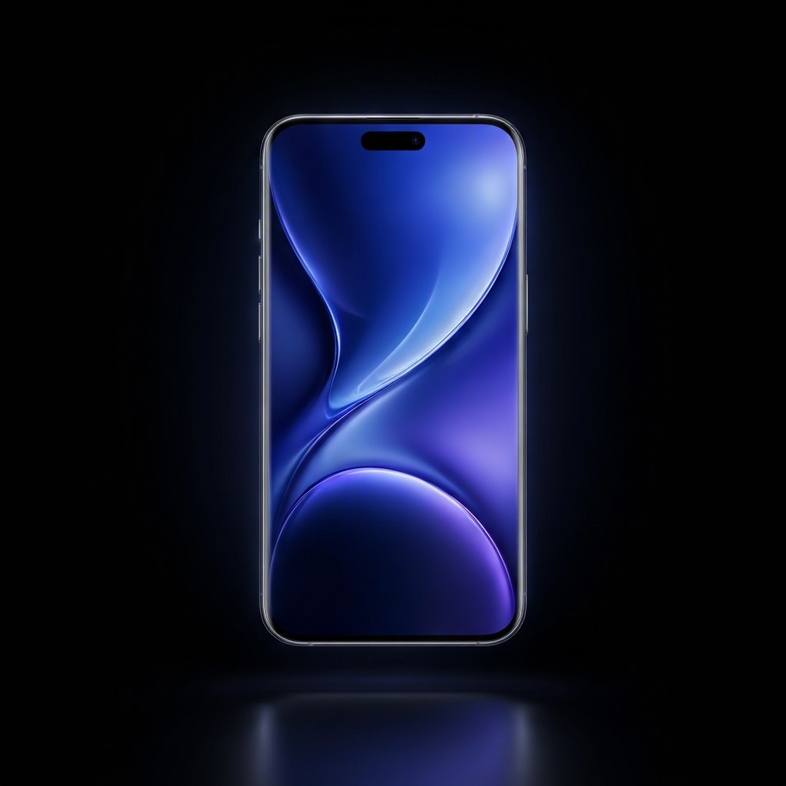
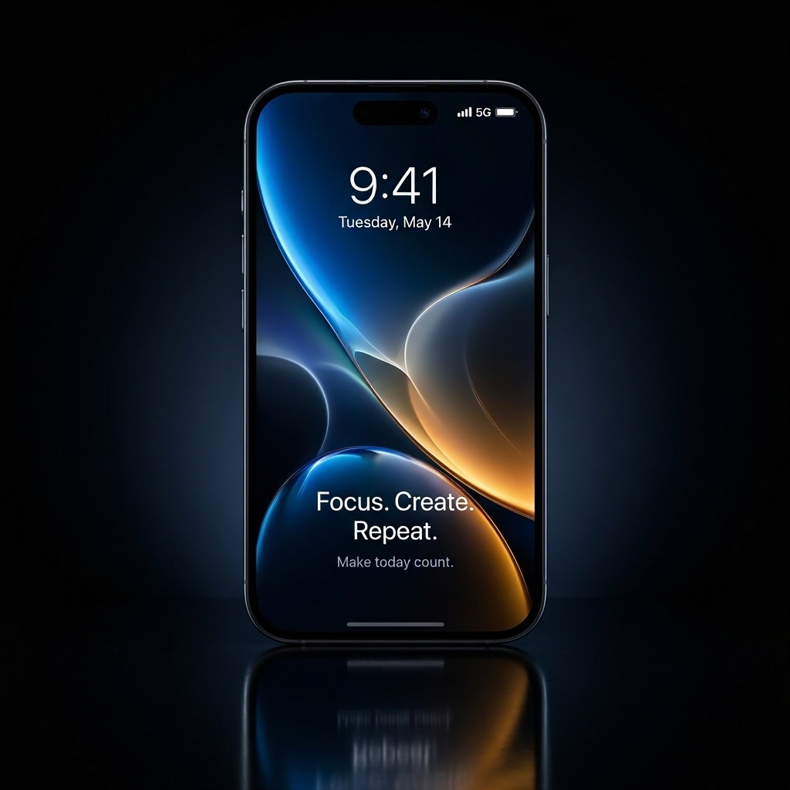
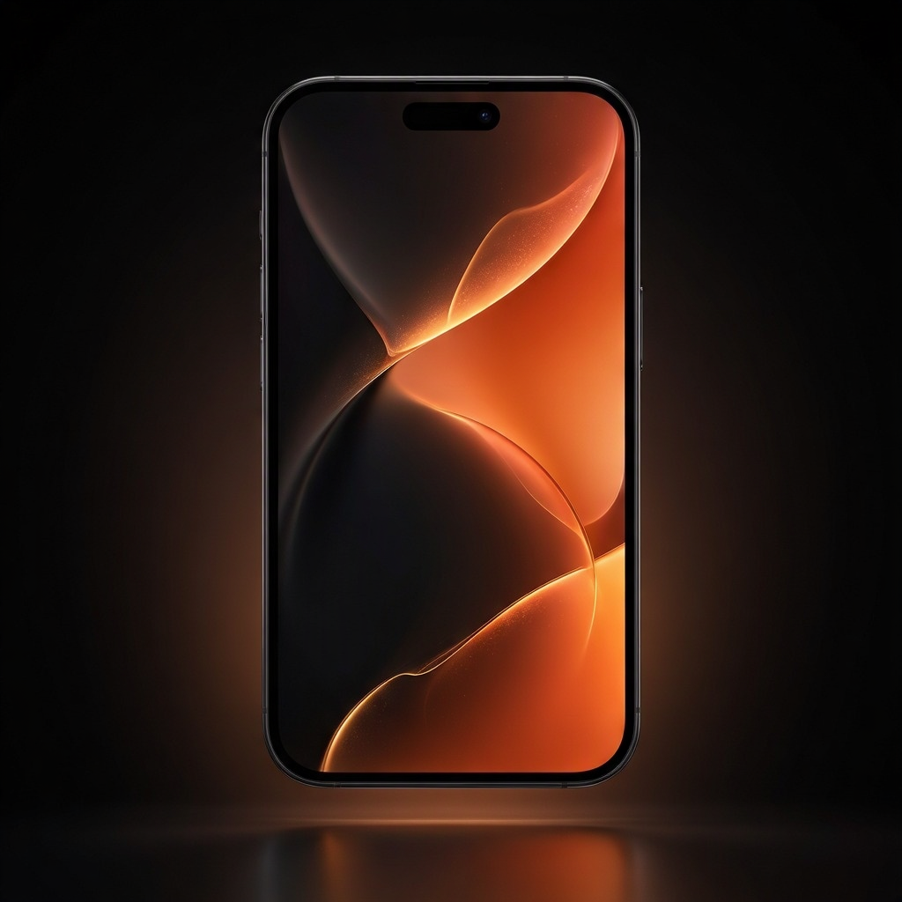
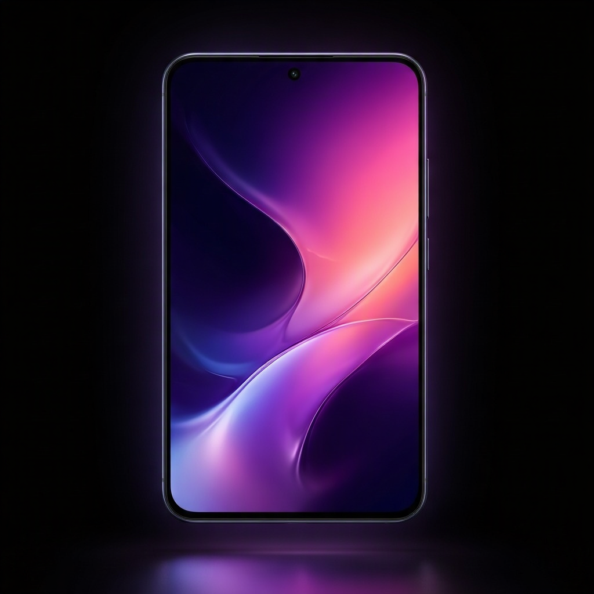

# OneiOS

> iOS 27 next to One UI on a rooted Samsung Galaxy S24 Ultra — switched to and back the way OneOS switches Androids. Nothing flashed, the image lives in a folder, One UI's kernel keeps running.

**Status: experimental, under active development.** On the phone it boots to the Home Screen (unlock works, GPU-composited at 40–60 fps, touch works) and returns to One UI. See [what works](#what-works) and [known issues](#known-issues) below — both are kept honest.

OneOS's guests are Android systems that run unchanged on One UI's Linux kernel. iOS's userland needs Apple's kernel (XNU), so OneiOS runs a source-built XNU **as a process on One UI's kernel** (`runtime/xnuhost`): iOS's processes are Linux processes whose system calls and faults go to it. How it fits together: [docs/architecture.md](docs/architecture.md).

## Quick start

Prerequisites: Linux x86_64 PC, the pinned Apple IPSW pieces (fetched, never committed), NDK 28.2, Rust 1.95+, `qemu-aarch64`. Full flow: [docs/building.md](docs/building.md).

```sh
P=iphone18,2-ios27.0.1-24A446
scripts/fetch/fetch.sh --list "$P"          # compare the profile with Apple's IPSW (~1 MiB)
scripts/bg.sh fetch scripts/fetch/fetch.sh "$P"   # the IPSW members from Apple, into inputs/
kernel/fetch.sh                             # the kernel's sources at the commits of kernel/pins.sh
scripts/bg.sh image scripts/image/build.sh "$P" --kernel out/kernel/24A446/kernel.kc
scripts/bg.sh kernel-hosted env HOSTED_OUT=me kernel/build-hosted.sh
scripts/bg.sh prelink env KERNEL=out/kernel/current-hosted-me/xnu.macho kernel/prelink/build.sh
runtime/build.sh STAGE                       # -> STAGE/bin/xnuhost and helpers
```

Long jobs run in tmux via `scripts/bg.sh NAME COMMAND...`; check them with `scripts/bg.sh -s NAME`.

## What works

| Area | Phone (S24 Ultra) | PC (qemu-aarch64) | Notes |
|---|---|---|---|
| Boot to Home Screen | Yes — lock screen, swipe unlock, apps shown (hosted 0035–0037) | Yes — launchd, SpringBoard, backboardd | [docs/booting](docs/building.md) §6 |
| GPU compositing | Yes, 40–60 fps via virtio-gpu | Yes, frames captured | [docs/gpu.md](docs/gpu.md) |
| Touch + buttons | Yes | Scripts (`--input-script`) | HID via kernel event driver |
| Battery | Published to iOS | Stand-in tested | Real readings on phone |
| Wi-Fi | Joins; late-enable fix merged, phone proof pending | Sim radio (`wifi=sim`) | [docs/hardware.md](docs/hardware.md) |
| Haptics / keyboard | Fix merged, phone proof pending | Host-tested | XPC-timeout cause proven from iOS log |
| Interrupts / Mach RPC | — | Verified: 41k host-call IPIs vs 110 trapped | `oneios-perf` `rpc:`/`0081:` lines |
| Return to One UI | Yes — chord, SIGKILL backstop | n/a | Never touches side keys, realtime, or `/sys/power` |
| Host test suites | n/a | All green (loader, xnuhost, bridges, display, prelink audit 0 failures) | `runtime/host-tests.sh` |

## Known issues

| Issue | State | Tracking |
|---|---|---|
| SpringBoard died once on unlock (missing process identity assertion) | Historical, not reproduced since | git history, agents board |
| Keyboard haptic XPC timeouts while typing | Fix merged (hosted 0078), phone proof pending | [docs/hardware.md](docs/hardware.md) §5 |
| Wi-Fi enable waits on configd (~3 min) | Fix merged (`oneios-wifi-up`), phone proof pending | [docs/hardware.md](docs/hardware.md) |
| HEVC encode: no real frame encoded yet | Guest side staged, stand-in tested | PR #59 |
| Camera capture device (iOS side) | Not built | [docs/hardware.md](docs/hardware.md) |
| Auto-brightness via light sensor | Attaches, no readings through it yet | [docs/hardware.md](docs/hardware.md) |
| Shared-region protect no-op count still 0 | Optimization unproven | kernel README "0080" |
| Mac kernel panics in first 2 s | Old news, Mac runtime boots with Linux `kernel.kc` | `kernel/prelink/README.md` |
| Never goals | Passcode, Face ID, Wallet, calls, SMS | — |

## Devices

Primary target: the rooted Galaxy S24 Ultra. S25 Ultra, S26 Ultra and Galaxy A-series run in forks; portable work lands here. Full map: [docs/forks.md](docs/forks.md).

| | Device | Status | Best result |
|---|---|---|---|
|  | Galaxy S24 Ultra (SM-S928, SM8650) — **this repo** | Boots to Home Screen, returns to One UI | Daily driver target |
|  | Galaxy S25 Ultra (SM-S938, SM8750) — [s25ver snapshot](https://github.com/xaxaapple/s25ver), denis fork (mirror) | Ported: Oryon topology fix, probe tool, metal fixes | Big-only-SoC bug fixed for all |
|  | Galaxy S26 Ultra (SM-S988, SM8850) — [YMGPwcca/OneiOS](https://github.com/YMGPwcca/OneiOS) | ~600 s iOS run on device | Haptics + backend tests ported |
|  | Galaxy A56 (SM-A566E, Exynos 1580) — [Musicalista/OneiOS-A56](https://github.com/Musicalista/OneiOS-A56) | iOS 16.5 to lock screen on device | GPU template, bootstrap, triage tools |

## Layout

```
docs/architecture.md  how the parts fit; docs/building.md  how to build and test; docs/*.md  each part in detail
docs/forks.md         device forks: what runs where, what was ported back, the multi-device pattern
profiles/             the pinned IPSW profile (iPhone18,2 iOS 27.0.1 24A446)
scripts/fetch/        fetch only the needed IPSW members from Apple's CDN (never from here)
scripts/image/        build the image set (manifest, SHA-256, .tar.zst)
userland/             iOS 27 root and Data tweaks (the image hook), guest helpers, the camera plug-in
kernel/               XNU 12377 (UniXNU / Droid-VM fork) built on Linux; oneios-hosted/ patches; prelink/ (kernel.kc)
runtime/              xnuhost and its loader, the display helper, the hardware bridges, the runtime package
drivers/              iOS-side drivers for the bridges (CPU, network, Bluetooth, haptics, audio, brightness, camera)
oneos/                the contract with the OneOS fork (akshaynexus/OneOS, branch oneios)
```

## Rules

- **No Apple files in git or in releases.** IPSWs, cryptexes, kernelcaches, kexts, `kernel.kc` and every image built
  from them stay in `out/` and `inputs/` (git-ignored). Scripts fetch them from Apple and build them on the owner's
  machine. Releases carry only this project's own code (scripts, runtime binaries, the OneOS patches); the kernel is
  built locally (it links Apple's corecrypto).
- Long jobs run in tmux: `scripts/bg.sh NAME COMMAND...`.
- Every change updates the docs that describe it: [CLAUDE.md](CLAUDE.md).

## License

No license file yet — all rights reserved until the owner adds one.

## Credits

[OneOS](https://github.com/fahadalijaved/OneOS) (fahadalijaved) and
[OneLineage](https://github.com/WeWaffles/OneLineage) (WeWaffles): the container hot-switch.
[MysticGSI](https://github.com/MysticGSI/mysticgsi): the image build model.
[UniXNU](https://github.com/UniXNU/UniXNU) and [Droid-VM](https://github.com/Droid-VM): XNU on non-Apple
ARM64, drm2kgsl, the guest drivers. [iOSPlus10](https://github.com/akshaynexus/iOSPlus10): XNU and iOS userland on
Qualcomm phones, haptics and brightness. [Darling](https://github.com/darlinghq/darling): Mach and XNU on Linux.
