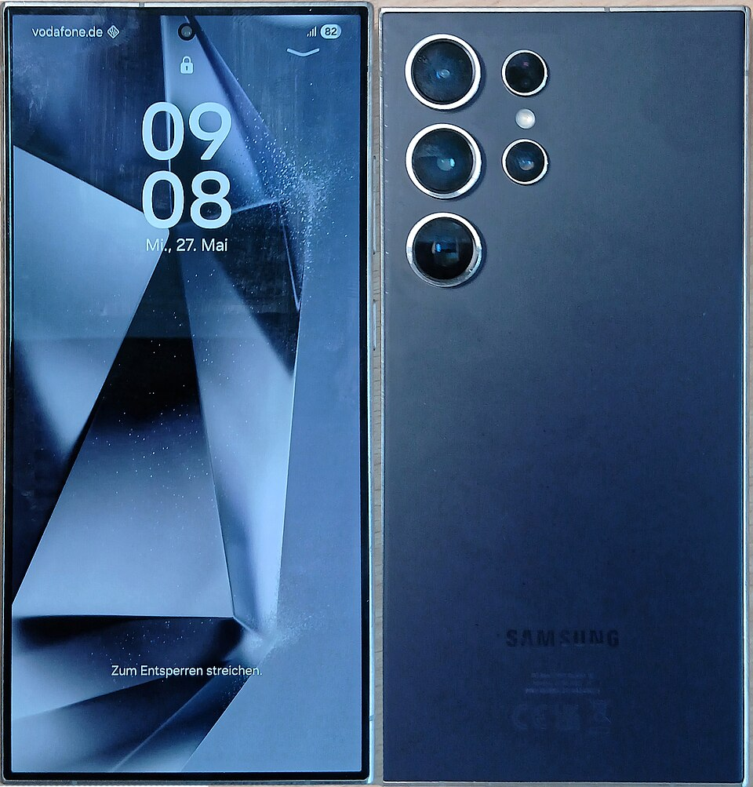
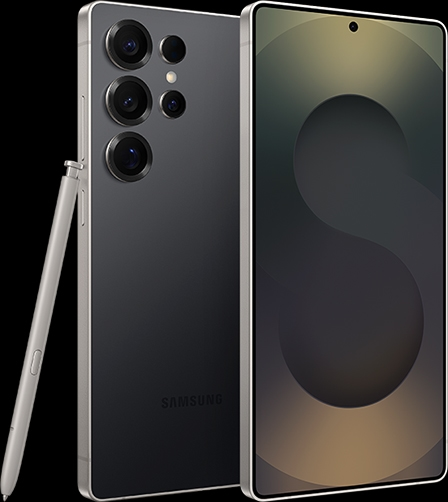
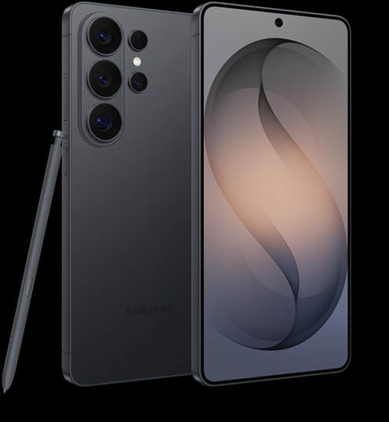

# OneiOS

> iOS 27 next to One UI on a rooted Samsung Galaxy S24 Ultra — switched to and back the way OneOS switches Androids. Nothing flashed, the image lives in a folder, One UI's kernel keeps running.

**Status: experimental, under active development.** On the phone it boots to the Home Screen (unlock works, GPU-composited, touch, keyboard and S Pen work) and returns to One UI. See [what works](#what-works) and [known issues](#known-issues) below — both are kept honest.

OneOS's guests are Android systems that run unchanged on One UI's Linux kernel. iOS's userland needs Apple's kernel (XNU), so OneiOS runs a source-built XNU **as a process on One UI's kernel** (`runtime/xnuhost`): iOS's processes are Linux processes whose system calls and faults go to it. How it fits together: [docs/architecture.md](docs/architecture.md).

## Quick start

Prerequisites: the build host is a Mac (Xcode, NDK 28.2, Rust 1.95+; Linux-only host tests run in Apple's `container`), or a Linux x86_64 PC with `qemu-aarch64`; the pinned Apple IPSW pieces (fetched, never committed). Full flow: [docs/building.md](docs/building.md).

```sh
P=iphone18,2-ios27.0.1-24A446
scripts/fetch/fetch.sh --list "$P"          # compare the profile with Apple's IPSW (~1 MiB)
scripts/bg.sh fetch scripts/fetch/fetch.sh "$P"   # the IPSW members from Apple, into inputs/
kernel/fetch.sh                             # the kernel's sources at the commits of kernel/pins.sh
scripts/bg.sh image scripts/image/build.sh "$P" --kernel out/kernel/24A446/kernel.kc
scripts/bg.sh kernel-hosted env HOSTED_OUT=me kernel/build-hosted.sh
scripts/bg.sh prelink env KERNEL=out/kernel/current-hosted-me/xnu.macho kernel/prelink/build.sh
runtime/build.sh STAGE                       # -> STAGE/bin/xnuhost and helpers
```

Long jobs run in tmux via `scripts/bg.sh NAME COMMAND...`; check them with `scripts/bg.sh -s NAME`.

## What works

| Area | Phone (S24 Ultra) | PC (qemu-aarch64) | Notes |
|---|---|---|---|
| Boot to Home Screen | Yes — lock screen, swipe unlock, apps shown (hosted 0035–0037) | Yes — launchd, SpringBoard, backboardd | [docs/booting](docs/building.md) §6 |
| GPU compositing | Yes, via virtio-gpu: 40–58 fps on the idle lock screen (2026-11-11); 20–32 fps in launches and Control Center (2026-11-22, cause found: see "Known issues") | Yes, frames captured | [docs/gpu.md](docs/gpu.md) |
| Touch + buttons | Yes | Scripts (`--input-script`) | HID via kernel event driver |
| Battery | Published to iOS | Stand-in tested | Real readings on phone |
| Wi-Fi | Joins; scan rate cut 20→5/min (reuse works); the late enable proven (2026-11-22: `en0` up 0.05 s after configd names it) | Sim radio (`wifi=sim`) | [docs/hardware.md](docs/hardware.md) |
| Keyboard | Yes (hosted 0083, 2026-11-22): Spotlight took 30 key taps, its hangs 3.8 s in all (86.4 s before) | Host-tested | The busy keyboard was the dictation availability loop, kernel README "0083" |
| Haptics | The haptic server starts (0078); the Actuator then played silence (no DSP chain): hosted 0086 merged, phone proof pending | Host-tested | [docs/hardware.md](docs/hardware.md) §5 |
| Interrupts / Mach RPC | — | Verified: 41k host-call IPIs vs 110 trapped | `oneios-perf` `rpc:`/`0081:` lines |
| Return to One UI | Yes — chord, SIGKILL backstop | n/a | Never touches side keys, realtime, or `/sys/power` |
| Host test suites | n/a | All green (loader, xnuhost, bridges, display, prelink audit 0 failures) | `runtime/host-tests.sh` |

## Known issues

| Issue | State | Tracking |
|---|---|---|
| SpringBoard died once on unlock (missing process identity assertion) | Historical, not reproduced since | git history, agents board |
| Launch, Control Center and widget lag; SpringBoard hangs (90 in one boot), chronod's widget kills (126) | Cause from the phone's `perf:` lines (2026-11-22): iOS's work stayed on the two A520 vCPUs (0% idle) while the six P vCPUs were 85–99% idle; hosted 0085 lets it move to the P cores, merged, phone proof pending | kernel README "0085" |
| The display glitches on UI changes (page changes, widget updates) | Fix merged (each layer buffer filled with what it lacks, `69e2013`), phone proof pending | [runtime/display/README.md](runtime/display/README.md) |
| Fitness shows black for 80–90 s at its first start | Not a render fault: its first screen waits on Fitness+ calls that fail slowly with no network (2026-11-22); 0085 removes the CPU part, the rest needs Wi-Fi joined | [docs/userland.md](docs/userland.md) §11 |
| Typing heat (Preferences 100%+ of a CPU, 2026-11-15) | The keyboard's busy main thread was the dictation availability loop (hosted 0083, the keyboard works on the phone); Preferences' CPU while typing not measured again since | [docs/hardware.md](docs/hardware.md) §5 |
| Wi-Fi scan and join slow | Scan reuse 20→5/min works; result/join latency still slow on the phone (cause open). The enable no longer waits on configd (`oneios-wifi-up`, proven 2026-11-22) | [docs/hardware.md](docs/hardware.md) |
| Audio: MMAP start gap, lateness metric | Landed on PC, phone proof pending | [docs/hardware.md](docs/hardware.md) |
| Volume keys and slider do nothing, sound low | Cause from iOS's log: no hardware volume control on the Speaker (audiomxd threw at every volume set), the host at One UI's media volume; the control and the host at full scale built, phone proof pending | [docs/hardware.md](docs/hardware.md) §6 "Volume" |
| HEVC encode: no tile encoded on the phone yet | Phone 2026-11-22, iOS 27's tile messages answered: widgets render (no more white fallbacks), encode-fail 0, the session loop gone; no HEIC tile coded yet | [codec README](kernel/patches/oneios-hosted/codec/README.md) |
| Camera: no Camera icon, no source in CMCapture | Phone 2026-11-22: the plug-in loads and makes its device, then CMCapture had no model name (`/product unique-model`) and no device-tree camera nodes; fixed in the loader (the nodes and `unique-model`; hosted 0084 keeps MobileGestalt's cache across boots and drops it once when the tree changes), phone proof pending | [docs/hardware.md](docs/hardware.md) §7 |
| Auto-brightness via light sensor | Attaches, no readings through it yet | [docs/hardware.md](docs/hardware.md) |
| Shared-region protect no-op count still 0 | Optimization unproven | kernel README "0080" |
| Mac kernel panics in first 2 s | Old news, Mac runtime boots with Linux `kernel.kc` | `kernel/prelink/README.md` |
| Kernels built from `main` between the A56 merge (`b2fa083`) and 2026-11-21 died at launchd (`mach_ports_lookup() failed: -300`, panic `initproc exited`) | Fixed: hosted 0068 is opt-in (`oneios-legacy-registered-ports=1`); PC boot to SpringBoard again | `kernel/patches/oneios-hosted/README.md` (A56 section) |
| Never goals | Passcode, Face ID, Wallet, calls, SMS | — |

## Devices

Primary target: the rooted Galaxy S24 Ultra. S25, S25 Ultra, S26 Ultra and Galaxy A-series run in forks; portable work lands here. Full map: [docs/forks.md](docs/forks.md).

| | Device | Status | Best result |
|---|---|---|---|
|  | Galaxy S24 Ultra (SM-S928, SM8650) — **this repo** | Boots to Home Screen, returns to One UI | Daily driver target |
|  | Galaxy S25 Ultra (SM-S938, SM8750) — [YumikoHayamato/OneiOS](https://github.com/YumikoHayamato/OneiOS) (branch `s25-ultra-sm8750`), denis fork, [s25ver snapshot](https://github.com/xaxaapple/s25ver) | SpringBoard, touch and the key return on device (fork sessions 1-7); ported: Oryon topology, Adreno 830 fences, the thermal trips rule, udmabuf ENOMEM fallback | Big-only-SoC bug fixed for all |
| | Galaxy S25 (SM-S931B, SM8750) — [NoNameBuilder/OneiOS](https://github.com/NoNameBuilder/OneiOS) | Source-level port, no on-device run; ported: host profile, stand-in tests, firmware facts | `panel-fallback=1080x2340@120` by detection |
|  | Galaxy S26 Ultra (SM-S988, SM8850) — [YMGPwcca/OneiOS](https://github.com/YMGPwcca/OneiOS) | ~600 s iOS run on device | Haptics + backend tests ported |
|  | Galaxy A56 (SM-A566E, Exynos 1580) — [Musicalista/OneiOS-A56](https://github.com/Musicalista/OneiOS-A56) | iOS 16.5 to lock screen on device; touch works in the fork since 2026-11-21 (its kernel patch 0079, not here yet) | GPU template, bootstrap, triage tools |

Device photos: official Samsung product images ([samsung.com](https://www.samsung.com/us/smartphones/galaxy-s25-ultra/), Samsung Newsroom press kits), © Samsung Electronics — used for device identification. A56 photo: [Captainmorlypogi1959 via Wikimedia Commons](https://commons.wikimedia.org/wiki/File:Samsung_Galaxy_A56_5G_2025_(cropped).jpg) (CC BY-SA 4.0).

## Layout

```
docs/architecture.md  how the parts fit; docs/building.md  how to build and test; docs/*.md  each part in detail
docs/forks.md         device forks: what runs where, what was ported back, the multi-device pattern
profiles/             the pinned IPSW profile (iPhone18,2 iOS 27.0.1 24A446)
scripts/fetch/        fetch only the needed IPSW members from Apple's CDN (never from here)
scripts/image/        build the image set (manifest, SHA-256, .tar.zst)
userland/             iOS 27 root and Data tweaks (the image hook), guest helpers, the camera plug-in
kernel/               XNU 12377 (UniXNU / Droid-VM fork) built on Linux; oneios-hosted/ patches; prelink/ (kernel.kc)
runtime/              xnuhost and its loader, the display helper, the hardware bridges, the runtime package
drivers/              iOS-side drivers for the bridges (CPU, network, Bluetooth, haptics, audio, brightness, camera)
oneos/                the contract with the OneOS fork (akshaynexus/OneOS, branch oneios)
```

## Rules

- **No Apple files in git or in releases.** IPSWs, cryptexes, kernelcaches, kexts, `kernel.kc` and every image built
  from them stay in `out/` and `inputs/` (git-ignored). Scripts fetch them from Apple and build them on the owner's
  machine. Releases carry only this project's own code (scripts, runtime binaries, the OneOS patches). The default
  kernel is built locally (it links Apple's corecrypto); a release carries only the hosted `ONEIOS_CRYPTO=original`
  `xnu.macho` (no Apple code in it), which each phone prelinks into its own `kernel.kc` ([docs/releases.md](docs/releases.md)).
- Long jobs run in tmux: `scripts/bg.sh NAME COMMAND...`.
- Every change updates the docs that describe it: [CLAUDE.md](CLAUDE.md).

## License

No license file yet — all rights reserved until the owner adds one.

## Credits

[OneOS](https://github.com/fahadalijaved/OneOS) (fahadalijaved) and
[OneLineage](https://github.com/WeWaffles/OneLineage) (WeWaffles): the container hot-switch.
[MysticGSI](https://github.com/MysticGSI/mysticgsi): the image build model.
[UniXNU](https://github.com/UniXNU/UniXNU) and [Droid-VM](https://github.com/Droid-VM): XNU on non-Apple
ARM64, drm2kgsl, the guest drivers. [iOSPlus10](https://github.com/akshaynexus/iOSPlus10): XNU and iOS userland on
Qualcomm phones, haptics and brightness. [Darling](https://github.com/darlinghq/darling): Mach and XNU on Linux.
